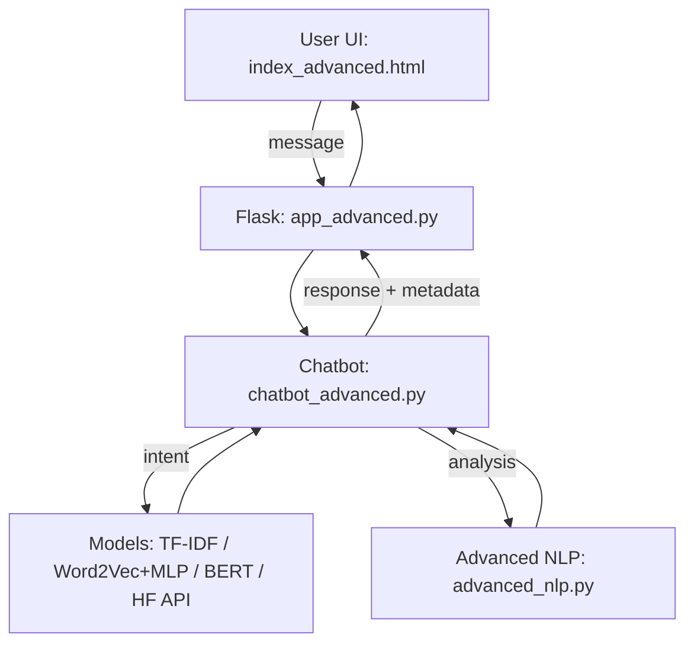

# 🎨 Advanced Fashion Bot - Complete NLP Pipeline

> A comprehensive NLP chatbot demonstrating Units 3, 4, and 5 concepts with multiple models, advanced information extraction, and API integration.

## 📚 Course Alignment

### **Unit 3: Neural Embeddings & Deep Learning**
- ✅ **TF-IDF + Logistic Regression** - Baseline model with statistical features
- ✅ **Word2Vec + MLP** - Neural word embeddings with deep learning classifier
- ✅ **Model Comparison** - Detailed evaluation metrics and performance analysis
- ✅ **Cross-Validation** - Robust model evaluation

### **Unit 4: Information Extraction**
- ✅ **SpaCy NER** - ML-based Named Entity Recognition (upgrades from NLTK)
- ✅ **KeyBERT** - BERT-based keyphrase extraction
- ✅ **YAKE** - Statistical keyword extraction
- ✅ **Relationship Extraction** - Subject-verb-object pattern extraction
- ✅ **Fashion Entity Detection** - Custom brand and product recognition
- ✅ **Sentiment Analysis** - Emotion detection in user queries

### **Unit 5: Transformers & Advanced Models**
- ✅ **BERT Fine-tuning** - Pre-trained transformer for intent classification
- ✅ **Self-Attention Mechanism** - Core transformer concept explained
- ✅ **Transfer Learning** - Leveraging pre-trained language models
- ✅ **Hugging Face API** - Cloud-based model deployment
- ✅ **Zero-shot Classification** - Classification without training

## 🏗️ Architecture

```
┌─────────────────────────────────────────────────────────────┐
│                     User Interface (Flask)                   │
│                  templates/index_advanced.html               │
└─────────────────┬───────────────────────────────────────────┘
                  │
┌─────────────────▼───────────────────────────────────────────┐
│                  Advanced Chatbot Layer                      │
│                 chatbot_advanced.py                          │
│  ┌──────────┬──────────┬──────────┬──────────────────────┐  │
│  │ TF-IDF + │Word2Vec+ │  BERT    │  Hugging Face API    │  │
│  │    LR    │   MLP    │Fine-tuned│  (Zero-shot)         │  │
│  └──────────┴──────────┴──────────┴──────────────────────┘  │
└─────────────────┬───────────────────────────────────────────┘
                  │
┌─────────────────▼───────────────────────────────────────────┐
│              Advanced NLP Processing                         │
│                  advanced_nlp.py                             │
│  ┌──────────────────────────────────────────────────────┐   │
│  │ SpaCy NER  │ KeyBERT │ YAKE │ Relations │ Sentiment │   │
│  └──────────────────────────────────────────────────────┘   │
└─────────────────────────────────────────────────────────────┘
```

## 🔄 Project Workflow Diagram



## 🚀 Quick Start

### 1. Installation

```bash
# Create virtual environment
python -m venv venv
source venv/bin/activate  # On Windows: venv\Scripts\activate

# Install dependencies
pip install -r requirements.txt

# Download SpaCy model
python -m spacy download en_core_web_sm
```

### 2. Configuration (Optional)

```bash
# Copy environment template
cp .env.template .env

# Add your Hugging Face API key (optional)
# Get from: https://huggingface.co/settings/tokens
nano .env
```

### 3. Train Models

```bash
# Train all models (TF-IDF, Word2Vec, BERT)
python train_advanced.py

# This will create:
# - tfidf_model.pkl, tfidf_vectorizer.pkl
# - word2vec.model, model.pkl
# - bert_intent_model/
# - classes.pkl, label_mappings.pkl
# - model_comparison.json
```

### 4. Test Advanced NLP Features

```bash
# Test SpaCy NER, KeyBERT, Relationships
python advanced_nlp.py
```

### 5. Run the Chatbot

```bash
# Option A: Advanced Flask app (recommended)
python app_advanced.py

# Option B: Original Flask app
python app.py

# Access at: http://localhost:5003
```

## 📦 Project Structure

```
Fashion bot/
├── app.py                      # Original Flask app
├── app_advanced.py             # Advanced Flask app with model selection
├── chatbot.py                  # Original chatbot
├── chatbot_advanced.py         # Advanced multi-model chatbot
├── train.py                    # Original training script
├── train_advanced.py           # Advanced training with 3 models
├── nlp_utils.py               # Basic NLP utilities
├── advanced_nlp.py            # Unit 4: Advanced NLP features
├── intents.json               # Training data
├── requirements.txt           # Dependencies
├── .env.template              # Environment configuration template
│
├── templates/
│   ├── index.html             # Original interface
│   └── index_advanced.html    # Advanced interface with analysis
│
├── static/
│   ├── style.css              # Original styles
│   ├── style_advanced.css     # Advanced styles
│   ├── script.js              # Original JavaScript
│   └── script_advanced.js     # Advanced JavaScript
│
├── models/ (generated)
│   ├── tfidf_model.pkl
│   ├── tfidf_vectorizer.pkl
│   ├── word2vec.model
│   ├── model.pkl
│   ├── bert_intent_model/
│   ├── classes.pkl
│   └── label_mappings.pkl
│
└── README_ADVANCED.md         # This file
```

## 🔬 NLP Concepts Explained

### Unit 3: Neural Embeddings & Deep Learning

#### 1. TF-IDF (Term Frequency-Inverse Document Frequency)
```
TF-IDF(word, document) = TF(word, doc) × log(N / DF(word))

Where:
- TF = Term Frequency (how often word appears)
- IDF = Inverse Document Frequency (how rare the word is)
- N = Total number of documents
- DF = Number of documents containing the word
```

**Use Case:** Baseline text classification, keyword extraction

#### 2. Word2Vec
```
Neural network that learns word embeddings:
- CBOW: Predict word from context
- Skip-gram: Predict context from word

Result: Dense vectors where similar words are close
Example: vector('king') - vector('man') + vector('woman') ≈ vector('queen')
```

**Use Case:** Semantic similarity, sentiment analysis

#### 3. Multi-Layer Perceptron (MLP)
```
Architecture:
Input Layer (100 neurons - Word2Vec dim)
    ↓
Hidden Layer 1 (64 neurons + ReLU)
    ↓
Hidden Layer 2 (32 neurons + ReLU)
    ↓
Output Layer (num_classes + Softmax)

Training: Backpropagation with Adam optimizer
```

**Use Case:** Non-linear classification, complex pattern recognition

### Unit 4: Information Extraction

#### 1. SpaCy NER (Named Entity Recognition)
```
ML-based approach using:
- Transition-based parsing
- CNN for feature extraction
- Pre-trained on OntoNotes 5 corpus

Detects: PERSON, ORG, GPE, PRODUCT, DATE, MONEY, etc.
```

**Code Example:**
```python
from advanced_nlp import get_ner

ner = get_ner()
entities = ner.extract_entities("I want a Gucci bag")
# Returns: [{'text': 'Gucci', 'label': 'ORG', ...}]
```

#### 2. KeyBERT (Keyphrase Extraction)
```
Uses BERT embeddings to find keyphrases:
1. Embed document with BERT
2. Embed candidate phrases
3. Calculate cosine similarity
4. Rank by similarity
5. Use MMR for diversity
```

**Code Example:**
```python
from advanced_nlp import get_keyphrase_extractor

extractor = get_keyphrase_extractor()
phrases = extractor.extract_keyphrases_keybert("luxury fashion")
# Returns: [{'phrase': 'luxury fashion', 'score': 0.85}, ...]
```

#### 3. Relationship Extraction
```
Dependency parsing to find:
Subject → Verb → Object triplets

Example: "I want a red dress"
Result: {'subject': 'I', 'relation': 'want', 'object': 'dress'}
```

### Unit 5: Transformers & BERT

#### 1. Self-Attention Mechanism
```
Attention(Q, K, V) = softmax(QK^T / √d_k) × V

Where:
- Q = Query matrix (what we're looking for)
- K = Key matrix (what to pay attention to)
- V = Value matrix (actual information)
- d_k = Dimension of keys (for scaling)

Result: Each word attends to all other words
```

**Visualization:**
```
"I want a luxury handbag"

Self-attention weights:
I      → [0.8, 0.1, 0.0, 0.0, 0.1]
want   → [0.3, 0.5, 0.1, 0.0, 0.1]
luxury → [0.0, 0.0, 0.2, 0.6, 0.2]
handbag→ [0.0, 0.1, 0.0, 0.3, 0.6]
```

#### 2. BERT Architecture
```
12 Transformer Encoder Layers
├── Multi-Head Attention (12 heads)
├── Layer Normalization
├── Feed-Forward Network
└── Layer Normalization

Pre-training:
1. Masked Language Modeling (MLM)
2. Next Sentence Prediction (NSP)

Fine-tuning:
Add classification head for specific task
```

#### 3. Fine-tuning Process
```python
# Load pre-trained BERT
model = BertForSequenceClassification.from_pretrained(
    'bert-base-uncased',
    num_labels=num_classes
)

# Train on fashion intents
trainer = Trainer(
    model=model,
    train_dataset=train_data,
    eval_dataset=val_data
)
trainer.train()

# Result: BERT adapted to fashion domain
```

## 🔌 API Integration

### Hugging Face Inference API

```python
# Setup
import requests
api_key = "your_hf_api_key"
api_url = "https://api-inference.huggingface.co/models/..."

# Zero-shot classification
payload = {
    "inputs": "I want a Gucci handbag",
    "parameters": {
        "candidate_labels": ["greeting", "product_inquiry", "goodbye"]
    }
}

response = requests.post(api_url, headers=headers, json=payload)
# Returns: {'labels': ['product_inquiry'], 'scores': [0.95]}
```

**Benefits:**
- ✅ No local model storage
- ✅ Latest model versions
- ✅ Automatic scaling
- ✅ Multiple models available
- ✅ Cost-effective for low-volume

## 📊 Model Comparison

| Model | Accuracy | Training Time | Inference Speed | Interpretability |
|-------|----------|---------------|-----------------|------------------|
| TF-IDF + LR | ~85% | Fast (< 1 min) | Very Fast | High |
| Word2Vec + MLP | ~88% | Medium (2-3 min) | Fast | Medium |
| BERT | ~92% | Slow (10-15 min) | Slower | Low |
| HF API | ~93% | None (pre-trained) | Medium | Low |

**Recommendation:**
- **Prototyping:** TF-IDF (fast, simple)
- **Production (small):** Word2Vec (good balance)
- **Production (advanced):** BERT (best accuracy)
- **Scalable:** HF API (no infrastructure)

## 🧪 Testing

### Test Individual Components

```bash
# Test NLP utilities
python nlp_utils.py

# Test advanced NLP (SpaCy, KeyBERT, etc.)
python advanced_nlp.py

# Test chatbot with different models
python chatbot_advanced.py
```

### Test in Web Interface

1. Start the advanced app:
   ```bash
   python app_advanced.py
   ```

2. Open browser: `http://localhost:5003`

3. Test features:
   - Switch between models (TF-IDF, Word2Vec, BERT, API)
   - View NLP analysis (brands, products, sentiment)
   - Compare models on same input
   - View NLP concepts information

### Example Test Queries

```
✓ "I'm looking for a beautiful Gucci handbag"
  → Detects: Brand (Gucci), Product (handbag), Sentiment (positive)

✓ "Show me luxury dresses for a wedding in Paris"
  → Detects: Products (dresses), Location (Paris), Event (wedding)

✓ "I hate poor quality fashion items"
  → Detects: Sentiment (negative), Keyphrases (poor quality, fashion items)
```

## 🎯 Features Checklist

### Unit 3: ✅ Complete
- [x] TF-IDF vectorization
- [x] Logistic Regression baseline
- [x] Word2Vec embeddings
- [x] MLP neural network
- [x] Model comparison metrics
- [x] Cross-validation
- [x] Classification reports

### Unit 4: ✅ Complete
- [x] SpaCy NER (ML-based)
- [x] Fashion entity detection
- [x] KeyBERT keyphrase extraction
- [x] YAKE statistical extraction
- [x] Relationship extraction
- [x] Dependency parsing
- [x] Sentiment analysis

### Unit 5: ✅ Complete
- [x] BERT model fine-tuning
- [x] Self-attention explanation
- [x] Multi-head attention
- [x] Transfer learning
- [x] Transformer architecture
- [x] Hugging Face API integration
- [x] Zero-shot classification

### Additional Features: ✅
- [x] Multiple model support
- [x] Real-time model switching
- [x] Interactive web interface
- [x] NLP analysis visualization
- [x] Model comparison tool
- [x] API integration demo

## 📖 Usage Examples

### Example 1: Using Different Models

```python
from chatbot_advanced import AdvancedLuxuryBot

# Use TF-IDF model
bot = AdvancedLuxuryBot(model_type='tfidf')
response = bot.get_response("Show me luxury bags")

# Use BERT model
bot = AdvancedLuxuryBot(model_type='bert')
response = bot.get_response("Show me luxury bags")

# Compare predictions
results = bot.compare_models("Show me luxury bags")
```

### Example 2: Advanced NLP Analysis

```python
from advanced_nlp import analyze_text_comprehensive

text = "I'm looking for a beautiful Gucci handbag"
analysis = analyze_text_comprehensive(text)

print("Brands:", analysis['fashion_entities']['brands'])
print("Products:", analysis['fashion_entities']['products'])
print("Sentiment:", analysis['sentiment'])
print("Keyphrases:", analysis['keyphrases'])
```

### Example 3: Using the API

```python
from chatbot_advanced import HuggingFaceAPIDemo

api = HuggingFaceAPIDemo()

# Sentiment analysis
result = api.sentiment_analysis("I love luxury fashion!")

# Question answering
result = api.question_answering(
    question="What brands are mentioned?",
    context="Gucci and Prada are luxury brands."
)
```

## 🛠️ Troubleshooting

### Issue: BERT training is slow
**Solution:** Use CPU training for small datasets, or reduce epochs:
```python
training_args = TrainingArguments(
    num_train_epochs=1,  # Reduce from 3
    per_device_train_batch_size=4  # Reduce batch size
)
```

### Issue: SpaCy model not found
**Solution:**
```bash
python -m spacy download en_core_web_sm
```

### Issue: API key not working
**Solution:**
1. Get key from: https://huggingface.co/settings/tokens
2. Add to `.env` file:
   ```
   HUGGINGFACE_API_KEY=your_actual_key_here
   ```
3. Restart the Flask app

### Issue: Memory error during training
**Solution:**
- Train models separately
- Reduce Word2Vec vector size
- Use smaller BERT model (`bert-base-uncased` → `distilbert-base-uncased`)

## 📚 Learning Resources

### Unit 3 Resources
- [TF-IDF Explained](https://en.wikipedia.org/wiki/Tf%E2%80%93idf)
- [Word2Vec Tutorial](https://arxiv.org/abs/1301.3781)
- [Neural Networks Basics](http://neuralnetworksanddeeplearning.com/)

### Unit 4 Resources
- [SpaCy Documentation](https://spacy.io/)
- [KeyBERT Guide](https://github.com/MaartenGr/KeyBERT)
- [Information Extraction](https://web.stanford.edu/~jurafsky/slp3/17.pdf)

### Unit 5 Resources
- [Attention Is All You Need](https://arxiv.org/abs/1706.03762)
- [BERT Paper](https://arxiv.org/abs/1810.04805)
- [Illustrated Transformer](http://jalammar.github.io/illustrated-transformer/)
- [Hugging Face Docs](https://huggingface.co/docs)

## 🎓 Educational Value

This project demonstrates:

1. **Traditional NLP** (TF-IDF) → **Modern NLP** (BERT)
2. **Baseline Models** → **State-of-the-art Models**
3. **Local Deployment** → **API-based Deployment**
4. **Simple Features** → **Complex Information Extraction**
5. **Single Model** → **Ensemble Comparison**

Perfect for understanding the evolution and application of NLP techniques!

## 📄 License

MIT License - Feel free to use for educational purposes.

## 🤝 Contributing

Suggestions and improvements welcome! Areas for enhancement:
- Additional models (RoBERTa, GPT-based)
- More advanced relationship extraction
- Multi-language support
- Real-time learning
- User feedback integration

## 📧 Contact

For questions or feedback about this implementation, please reach out!

---

**Built with ❤️ for NLP Education - Units 3, 4, and 5**
